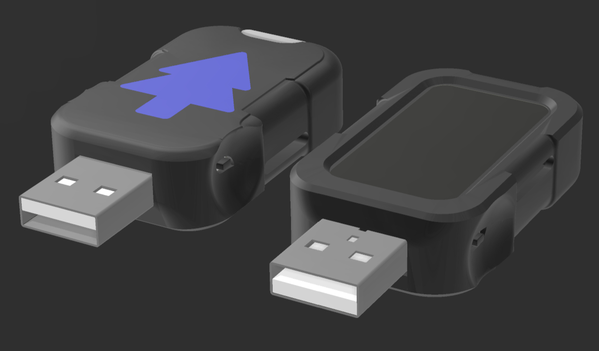
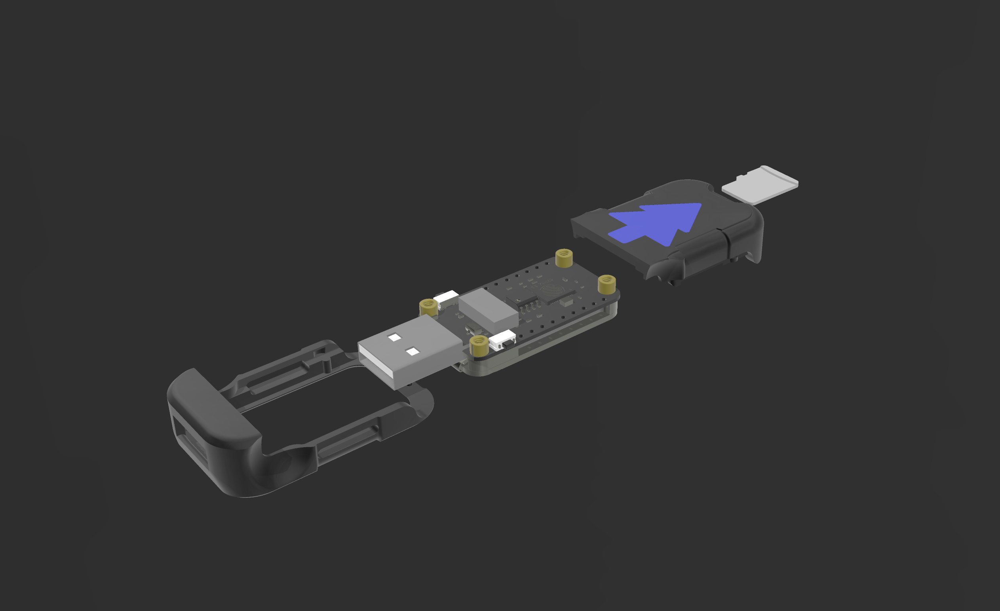

# <div align="center">Jcorp Nomad</div>

<div align="center">
  
</div>

<p align="center"><b>A portable, offline media server powered by the ESP32-S3 in a thumbdrive form factor.</b><br>
Stream movies, music, books, and shows anywhere - no internet required.</p>

<p align="center">
  
  
  
  
</p>

<p align="center">
  <a href="https://nomad.jcorptech.net"><b>Buy a Prebuilt Nomad</b></a> &nbsp;|&nbsp;
  <a href="https://ko-fi.com/jcorptech"><b>Support on Ko-fi</b></a>
</p>

---

> **Experimental Branch** - This is where new stuff lands before it goes to main. Everything on main is here too, this just adds on top of it.
>
> This update is 4.8, and it's a big one (The usual). While a lot of it is under the hood (several people streaming at once holds up a lot better now), there's also a lot of new stuff on the pages, Watch Together, a rebuilt admin panel, firmware updates without a PC, offline archives served by Nomad itself (which means every format works), and rebuilt maps. The full list is below.
>
> Fair warning, this branch gets less testing than main. If something breaks, tell me, that is what this branch is for.
>
> Firmware and the SD card template both change here, so you'll need to reflash and refresh your card files.

---

## What is Nomad

Jcorp Nomad is an open-source offline media server designed for travel, remote work, classrooms, camping, and more. It's the size of a USB drive and plugs straight into a USB port for power. It runs entirely on an ESP32-S3, creates a local Wi-Fi hotspot, and serves media through a browser interface. Multiple users can access separate media streams simultaneously, all without internet access.

This project is compact, easy to modify, and includes optional 3D-printable hardware. Both firmware and web interface are fully open-source.

---

## Get a Nomad

### Build It Yourself (Recommended)

I strongly recommend building your own Nomad. It's not a very difficult project, if you can follow instructions and plug in a USB drive, you can do it. The parts are cheap, widely available, and the whole build takes under an hour. See Hardware Requirements and Quick Start below. If nothing else please check out the DIY option before purchasing. 

### Buy a Prebuilt

That said, I also won't say no to money. If you'd rather skip the DIY and get a ready-to-go unit, prebuilt Nomads are available at **[nomad.jcorptech.net](https://nomad.jcorptech.net)**.

Every Nomad, whether you build it or buy it, runs the same open-source firmware and web interface. When new features and updates are released, you can always flash the latest code yourself to stay up to date. 

### Support Development

If you just want to support the project, donations are always appreciated:  
**[ko-fi.com/jcorptech](https://ko-fi.com/jcorptech)**

---

## What's New in 4.8

- **Several people at once:** Four films play smooth at the same time in my testing now, and pages don't come back half loaded when Nomad is busy, they just take a second longer. Uploads pick up where they left off if the connection drops, and big downloads actually finish. This testing is done in a college dorm, so better results can be had camping / in the wild with less network traffic. 
- **Archives served by Nomad:** Wikipedia and the other ZIM archives are served by Nomad itself now, so they work on every phone without any setup on the phone side.
- **Maps rebuilt:** Vector map packs, turn by turn with voice and rerouting, search for addresses and coordinates, Nearby for things like hospitals, water and gas, and it follows your theme. Phones too old for the full map get a basic one instead.
- **Admin panel redone:** Split into sections, a sign in where the password never gets sent over the air (and more than one device can stay signed in), switches per page for what people can see, download or upload, Activity to see and stop what's playing, card health, and a WiFi QR code.
- **Firmware updates without a PC:** From a file or straight from the flasher site. Only signed builds are accepted, and if a new build doesn't start right it goes back to the old one on its own.
- **Watch Together:** One person hosts, everyone else joins with a code, and you can vote on what to watch.
- **Movies & Shows:** Simpler resume, progress on every episode, Up next, seek previews, and subtitles that stay on through episode changes.
- **Music:** Now playing, no gap between songs, a sleep timer and sound settings.
- **Books:** Progress and Continue on everything, audiobooks that run on through a book in parts, read aloud for e-books, and bookmarks and notes. PDFs and comics open a lot quicker too.
- **Gallery & Files:** A proper photo viewer with folders and thumbnails, and Files can open docs, slides and sheets.
- **Games:** Gzipped ROMs start in about half the time, and there's a Toolkit with some everyday tools.
- **Translate:** A conversation mode for going back and forth.
- **Chat:** Kept by Nomad now, so messages don't get lost or show up out of order.
- **Safe mode and a support file:** If it crashes a few times in a row it starts in safe mode, and the admin panel can save a support file you can send me when troubleshooting.

### Streaming holds up under load

When too many people connect at once, Nomad now says it's busy instead of stalling.

- When several devices pull at once, Nomad now reserves a slot before it starts the work. Before, it checked free memory at the start of a request but didn't use it until much later, so a burst of requests could all pass the check together. Six at once could take free memory from 70 KB down to 20 KB, below the limit that was supposed to prevent that.
- If it is actually full you get a "busy, try again" instead of a stall, and the players handle that fine.
- A stuck stream gives its slot back after a while, so a phone that walks out of range doesn't keep it locked up. 
- **Hotspot goes from 8 devices to 10.** 8 was inherited from the Mk4 and was never actually measured, the radio driver allows 10 so I am using all the slots now. 

### Direct file links actually stream

If something asked for `/Movies/film.mp4` directly instead of going through the site, it got the whole file with no seeking, and it didn't count towards the limits above. DLNA players, VLC and other outside apps ask for files that way, so they skipped all of it. Those go through the proper handler now.

### Mobile fixes

- General cleanup of controls and new vector icons to make everything a bit more clean looking and fit on small screens
- Updated resume section to fit better on mobile and handle more items without breaking.

### Smaller things

- `.avif` and `.bmp` images serve correctly now instead of downloading
- Paths with doubled slashes fold properly, which is what made `/Archive` and `//Archive` behave differently
- The `/config` folder is properly off limits no matter how the path is spelled
- The health readout reports the memory the card actually needs, not just free heap
- A game no longer gets stuck while it's thinking, the search index updates properly, and 248 lines of dead code that got leftover in the last push are gone
- **`tools/flash-nomad.sh`** - compiles, flashes and waits for the hotspot to come back. **No more unplugging the board after a flash.** It resets through the watchdog instead of the serial line, since the S3's USB port can't really do that. `--usbc` builds for the 1.47B board.

---

## Features

- **exFAT & FAT32:** Any card format, auto detected at boot. Cards over 32GB and files over 4GB both work.
- **WiFi Mode:** Join an existing WiFi network instead of running the hotspot, with automatic fallback so you can't lock yourself out. Also the fix for TV sticks that won't do anything on a network with no internet.
- **TV Support (DLNA):** Shows up as a media server for smart TVs, VLC, Kodi and friends, with cover art and seeking.
- **Offline Encyclopedia:** ZIM archives (Wikipedia, Gutenberg, TED and others) served by Nomad itself, with fast search.
- **Offline Maps:** Vector map packs with place search, Nearby, and turn by turn directions with voice and rerouting.
- **Offline Translation:** In-browser translation between installed language pairs, with a conversation mode, no internet ever.
- **Games:** ROMs play in the browser through EmulatorJS (the cores ship on the card), plus ten built-in games and DOOM (this is here so I can say it runs doom, you must keep this on the card it is load bearing.. I swear lol)
- **Local Multiplayer:** Two player game rooms over Nomad's own WiFi, no internet needed.
- **Watch Together:** Pick something as a group and everyone watches it at the same moment.
- **Chat:** A simple local chat room for everyone connected to Nomad.
- **Cookbook:** Recipe library with tick-off ingredient and step checklists.
- **Workshop:** 3D-print model library with an in-browser STL/3MF/OBJ preview.
- **Subtitles:** Sidecar subtitle files attach themselves to a video by filename, with selectable language tracks.
- **Firmware Updates:** Update from the admin panel with a signed build, no PC needed, and it rolls back on its own if the new one fails.
- **Admin Panel:** Device controls, library indexing, per page switches, Activity, card health, themes and a WiFi QR code, behind a sign in.
- **Themes:** 28 built in, plus a Theme Customizer for making your own.
- **File Browser:** Upload, rename, delete, download, and inline file editing. (Recommended to use a PC)
- **Global Search:** Quickly find media across all categories from the Menu page.
- **Music Player:** Background playback with no gap between songs, subdirectory playlists and a Queue.
- **Movies & Shows:** Season and special folder support, Up next, seek previews and resume on every episode.
- **Digital Library:** EPUB, PDF, a Comic/Webtoon reader, audiobooks, and read aloud for e-books.
- **Gallery & Files:** Photo viewer with folders and thumbnails, and Files opens docs, slides and sheets.
- **Captive Portal:** Joining the hotspot opens Nomad on its own.
- **Mobile-Friendly UI:** Built for phones first.

---

## Hardware Compatibility

Nomad is built specifically for the **Waveshare ESP32-S3 Dev Board (1.47" LCD version)**. Due to the number of low-level tricks used to squeeze this much functionality out of the hardware, it is difficult to get Nomad running on other boards.

There are a few community forks that target other ESP32 boards, but your mileage will vary. I'm also actively working on a **Nomad Lite** version with wider board compatibility, focused on basic streaming without all the advanced features. There's also an [ESP32-P4 branch](https://github.com/Jstudner/jcorp-nomad/tree/esp32-p4) for two of Waveshare's P4 boards, see What's Next.

---

## Hardware Requirements

- **Waveshare ESP32-S3 Dev Board (1.47" LCD version)** - [Amazon Link](https://amzn.to/4ktB6oT)

- **or the ESP32-S3-LCD-1.47B** - the USB-C board. Same chip, same everything, the LCD backlight just moves from GPIO 48 to GPIO 46. If you build it yourself, set `BOARD_USB_C` to 1 in `Display_ST7789.h`. If you flash from the browser, pick the USB-C build. Get it wrong and it boots functional, just no screen output.

- **microSD card, exFAT or FAT32 (16-128GB recommended, up to 2TB)**
  [Amazon Link](https://amzn.to/44tM1c4)

- **SD-Card Extender (optional, 3DP case compatible)**
  [Amazon Link](https://amzn.to/45IWIJz)

- **A USB port to plug it into** (a computer, a power bank or a USB wall plug)
- **Optional:** 3D-printed enclosure (STL files included)

### Case

<p align="center">
  
</p>

The case slides together **front-to-back**, so there's no direct pressure on the screen, which was a common cause of cracked screens on the old top-to-bottom case. The buttons stay exposed on the outside, so you can still flash firmware or hit the boot button without taking it apart.

---

## Flash It From Your Browser

If you would rather skip Arduino IDE entirely, **[nomadflash.jcorptech.net](https://nomadflash.jcorptech.net)** does the setup from a browser tab. The firmware is already compiled, so there is nothing to install and no SdFat version to line up. This system will lag a bit behind on the latest version, but makes setup much easier for most casual users. 

It covers three things:

- **Flash the firmware.** Plug Nomad into a USB port, pick a build, and it writes the bootloader, partition table and app in one image. Takes less than a minute.
- **Set up the SD card.** Copies the web interface onto the card and creates every media folder Nomad uses, including Games, Maps, Cookbook and Workshop. There is an optional test set of placeholder content if you want to see every page working before you load your own media.
- **Update an existing card.** Replaces only the interface files and leaves your media alone. (still WIP)

Both the main and experimental builds are there, and each is offered for both boards:

- **USB-A** for the ESP32-S3-LCD-1.47
- **USB-C** for the ESP32-S3-LCD-1.47B

Pick the one matching the connector on your board. The two differ only in which pin drives the LCD backlight, so flashing the wrong one boots fine but leaves the screen dark.

Formatting is the one step it cannot do, because a web page has no access to drives or partitions. You usually do not need it, since exFAT, FAT32 and FAT16 cards all mount as they come. If a card does need formatting, the site prints the exact command for Windows, macOS or Linux.

**Requires Chrome, Edge or Opera on a desktop.** It uses Web Serial and the File System Access API, which Firefox and Safari do not implement, and neither one works on iOS or Android.

---

## Software Requirements

- Arduino IDE, with the **esp32 board package 3.3.3**
- Arduino libraries, exact versions. These are what the shipped build compiles against, and mismatches here are the single most common build failure:
  - `ArduinoJson` by Benoit Blanchon **7.3.0**
  - `Async TCP` by ESP32Async **3.4.7**
  - `ESP Async WebServer` by ESP32Async **3.7.1**
  - `LVGL` by kisvegabor **8.3.10**
  - `SdFat` by Bill Greiman **2.3.0** - this one is required for exFAT, it is not optional
- SquareLine Studio (optional, for UI editing)

If you would rather not line any of that up, use the browser flasher above.

---

## Quick Start

1. Flash the ESP32-S3 firmware from `/firmware/` (or use the browser flasher above).
2. Copy `/SD_Card_Template/` files onto the card. Any exFAT or FAT32 card works as-is, you only need to format if the card is brand new or broken.
3. Place media in `/Movies`, `/Shows`, `/Books`, `/Music`, `/Gallery`, `/Files`, `/Games`, `/Cookbook`, `/Workshop`. (ZIMs, Maps and Translate packs get prepped with Nomad Tools, see below.)
4. Insert the SD card and plug Nomad into a USB port.
5. Connect to Wi-Fi `Jcorp_Nomad` with password: `password`.
6. Open the browser interface.
7. Open the admin panel (gear icon) → **Library index** → **Start scan**.
8. The first scan may take a few minutes on a big card.
9. Return to Menu page and enjoy your media!
10. Optional: to serve your home network (and TVs) instead of running a hotspot, open the admin panel → **WiFi Mode** and join your network from there.

---

## Folder Structure

```
/Movies
    Interstellar.mp4
    Interstellar.jpg

/Shows
    /The Office
        S01E01 - Pilot.mp4
        S01E02 - Diversity Day.mp4
    The Office.jpg

    /Gravity Falls
        /Season 1
            S1E1 - Tourist Trapped.mp4
            S1E2 - The Legend of the Gobblewonker.mp4
        /Season 2
            S2E1 - Scary-oke.mp4
            S2E2 - Into the Bunker.mp4
        Alex Hirsch Interview.mp4
    Gravity Falls.jpg

/Books
    The Martian.pdf
    The Martian.jpg
    /How to Train Your Dragon
        book1.pdf
        book2.mp3
        book1.jpg
        book2.jpg
    How to Train Your Dragon.jpg

/Music
    track01.mp3
    /Artist1
        track01.mp3
        /Album1
            track02.mp3
    /PersonName
        /Playlist1
            track01.mp3
        /Playlist2
            track02.mp3

/Gallery
    image01.jpg
    video01.mp4

/Files
    document.pdf
    example.txt

/Games
    Pokemon Red.gb
    Pokemon Red.png
    Freedoom.wad
    Chess.html
    Go.html

/Cookbook
    Grandma's Chili.md
    Grandma's Chili.jpg
    /Desserts
        Brownies.md

/Workshop
    /Brackets
        shelf bracket.stl
        README.txt

/Maps
    /pennsylvania
        manifest.json
        (map data, prepped with Nomad Tools)

/Translate
    manifest.json
    (language packs, installed with Nomad Tools)

/Archive
    wikipedia_en_all_maxi.zim
    /.nomad-zim
        (search index, built by Nomad Tools)

(plus the web interface files from SD_Card_Template, in the card's root)
```

---

## Supported Formats

- **Video:** `.mp4, .webm, .m4v` play everywhere. `.mkv, .avi, .mov` are listed too, but whether they play is down to your browser (Safari is usually fine with `.mov`, Chrome usually is not with `.mkv`). Remux to `.mp4`, or run **Fix videos** in Nomad Tools.
- **Audio:** `.mp3, .flac, .wav, .ogg, .aac, .m4a`, plus `.opus` with the same browser caveat as above.
- **Subtitles:** `.srt, .vtt, .ass, .ssa, .sub` - drop them next to the video with the same name. `Movie.srt` or `Movie.en.srt` both attach, language suffixes become selectable tracks, and `.srt` is converted to WebVTT on the fly because browsers render nothing for raw SRT.
- **Books:** `.pdf, .epub, .cbz, .cbr` 
- **Images:** `.jpg, .jpeg, .png, .webp, .gif, .bmp, .avif` 
- **Archives:** `.zim` (offline Wikipedia and other ZIM-format wikis), needs special processing, you cant just drop a .zim in sadly. Prep them with [Nomad Tools](https://github.com/Jstudner/Nomad-Tools) first (still rough, but handles most common ZIMs)
- **Games:** ROMs for the systems EmulatorJS supports (GB, GBC, GBA, NES, SNES, Genesis, and others), `.wad` files for DOOM, plus `.html` files for built-in games
- **Maps:** map packs from Nomad Tools, dropped into `/Maps`
- **Recipes:** `.md`, `.cook`, or `.json` files in `/Cookbook`
- **3D Models:** `.stl`, `.3mf`, `.obj` in `/Workshop`
- **Translation:** language packs installed into `/Translate` with Nomad Tools

---

## Nomad Tools

Some content needs a one-time prep step on your computer before Nomad can use it, ZIM archives need a search index built, maps need downloading, translation packs need fetching. [Nomad Tools](https://github.com/Jstudner/Nomad-Tools) is a simple menu that does all of it. Windows and Linux (macOS untested).

Basic usage:

1. Download Nomad Tools and put your Nomad card in the computer.
2. **Windows:** double-click `START-Windows.bat`. **Linux:** run `./start-linux.sh`.
3. Pick your card from the list (or type its path), then pick a job from the menu.

What the menu covers:

- **Add media** and **Check the card** - copies your stuff onto the card, or checks a card you filled yourself.
- **Add ZIM archives** and **Speed up archives** - Wikipedia, Gutenberg and so on with their search index, and reworked so they load faster.
- **Pictures** - Gallery previews, covers for books that don't have one, and smaller covers.
- **Fix videos** - finds videos that won't play, play without sound or are slow to start, and fixes them.
- **Subtitles** - pulls text subtitles out of your videos, and can make seek previews.
- **Speed up games** - compresses ROMs so each one starts in about half the time.
- **Rebuild the media index** - after you've added or removed files from the PC.
- **Map packs** - ready made maps by area with turn by turn directions and place search, or build them yourself from the newest OpenStreetMap data.
- **Translation languages** - offline translation packs, always both directions of a pair. (I recomend just grabbing all as its less than 4GB)
- **Format a card** - exFAT, Linux only.

A good order for a fresh card: media and ZIMs first, then Pictures, rebuild the index last. Maps and languages can be added any time.

---

## Known Rough Edges

Since this is the experimental branch, here's what I already know isn't great:

- **Maps are new.** They were rebuilt for 4.8 and have only been tested on a handful of packs. Long routes take a few seconds to work out on the device.
- **WiFi Mode and DLNA have seen few routers and few TVs.** They work (tested with VLC on a Fire Stick, desktop VLC, and phones), but there are a lot of both out there and I have tried a handful. If your TV can't find Nomad, tell me what TV it is and I will see what I can do.
- **Some video containers list but won't play.** `.mkv`, `.avi` and `.mov` get served without a content type, so it comes down to what your browser will sniff and decode. Nothing is broken on Nomad's side.
- **Set an admin password before using WiFi Mode.** On the hotspot only people you gave the password to can reach the admin panel. On your home network, everything on that network can. I dont hard gate this, but worth noting. 
- **Free space on FAT32 cards can read slightly wrong.** SdFat doesn't update the counter FAT32 keeps for it, so the number drifts by however much Nomad itself writes. It fixes itself the next time you plug the card into a PC, and it doesn't affect your files at all. exFAT cards aren't affected.
- **The first game on each system takes a moment.** Its emulator core loads off the card the first time, after that it's cached.
- The newer features have had a fraction of the testing the core has. If something breaks, tell me. Issues and PRs are both welcome.

---

## What's Next

**Nomad Lite** - A stripped-down version of Nomad with wider board compatibility, focused on core streaming features. In active development now that Mk4 is out.

**Gallion** - A larger-scale sibling to Nomad, built on more capable hardware. Gallion is designed to handle everything that couldn't fit on Nomad's current platform > ROM emulation, 4k video, and expanded media compatibility across the board. The current version is [here](https://github.com/Jstudner/Gallion).

**ESP32-P4** - I have said for a long time that I don't want to switch hardware, as doing so would leave yall with a useless board. The S3 is Nomad and it stays supported. That said, I have been co-developing a P4 version alongside it, because the P4 brings two things the S3 can't: a radio module that is already FCC certified, which matters a lot for anything I sell, and considerably faster WiFi. 

It has its own branch now, [esp32-p4](https://github.com/Jstudner/jcorp-nomad/tree/esp32-p4), on two boards. The **WIFI6** board is a stick, only a bit larger than your current Nomad. The **NANO** is noticeably bigger than either, but it adds an ethernet port with POE module support, and a USB port so storage can be expanded or replaced rather than living entirely on the SD card.

None of this is a replacement announcement. It's its own branch, the S3 keeps getting the same updates, just better speed and a few more features on the p4 branch. 

---

## Project Inspiration

Inspired by my experience running a Jellyfin server, I wanted a portable, low-cost solution for offline media streaming. Challenges with SBCs (Raspberry Pi, etc.) included high power usage, heat, and instability.

Nomad focuses on delivering:

- Offline access
- Wide device compatibility
- Simple frontend for media browsing and playback
- Multiple user support
- High customization potential

The ESP32-S3 provides enough performance to handle these requirements efficiently, in a pocket-sized form factor.

---

## License

[CC BY-NC-SA 4.0](https://creativecommons.org/licenses/by-nc-sa/4.0/) - free to remix and share for non-commercial use with attribution.

---

## Credits

Developed by **Jackson Studner (Jcorp Tech)**.
Inspired by open-source offline media projects. Contributions via PRs welcome.

<p align="center">
  <a href="https://ko-fi.com/jcorptech"></a>
</p>
