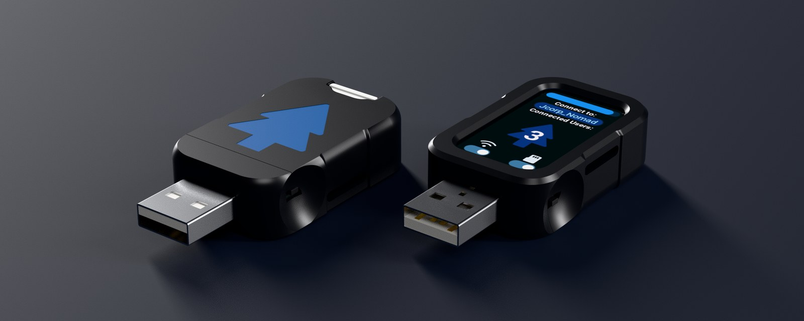
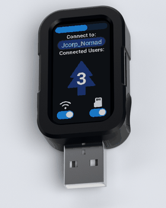
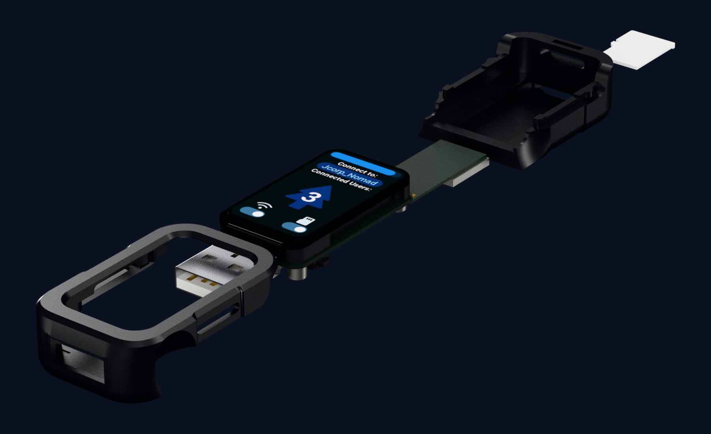

# <div align="center">Jcorp Nomad</div>

<div align="center">
  
</div>

<p align="center"><b>A portable, offline media server powered by the ESP32-S3 in a thumbdrive form factor.</b><br>
Stream movies, music, books, and shows anywhere - no internet required.</p>

<p align="center">
  
  
  
  
</p>

<p align="center">
  <a href="https://nomad.jcorptech.net"><b>Buy a Prebuilt Nomad</b></a> &nbsp;|&nbsp;
  <a href="https://ko-fi.com/jcorptech"><b>Support on Ko-fi</b></a>
</p>

---

> **Experimental Branch** - This is where new stuff lands before it goes to main. Everything on main is here too, this just adds on top of it.
>
> Mk5 (firmware 5.0) is the newest update here. It's coming so soon after 4.8 as I wasnt sure when to fully publish these changes. This is the "toybox" update of sorts, mainly adding a bunch of old code and ideas that didnt make sense to implement until now. In addition it also includes many enhancements and optimizations to the existing performance. 
>
>
> Fair warning, this branch gets less testing than main. If something breaks, tell me, that is what this branch is for.
>
> Firmware and the SD card template both change here, so you'll need to reflash and refresh your card files.

---

## What is Nomad

Jcorp Nomad is an open-source offline media server designed for travel, remote work, classrooms, camping, and more. It's the size of a USB drive and plugs straight into a USB port for power. It runs entirely on an ESP32-S3, creates a local Wi-Fi hotspot, and serves media through a browser interface. Multiple users can access separate media streams simultaneously, all without internet access.

This project is compact, easy to modify, and includes optional 3D-printable hardware. Both firmware and web interface are fully open-source.

---

## Get a Nomad

### Build It Yourself (Recommended)

I strongly recommend building your own Nomad. It's not a very difficult project, if you can follow instructions and plug in a USB drive, you can do it. The parts are cheap, widely available, and the whole build takes under an hour. See Hardware Requirements and Quick Start below. If nothing else please check out the DIY option before purchasing. 

### Buy a Prebuilt

That said, I also won't say no to money. If you'd rather skip the DIY and get a ready-to-go unit, prebuilt Nomads are available at **[nomad.jcorptech.net](https://nomad.jcorptech.net)**.

Every Nomad, whether you build it or buy it, runs the same open-source firmware and web interface. When new features and updates are released, you can always flash the latest code yourself to stay up to date. 

### Support Development

If you just want to support the project, donations are always appreciated:  
**[ko-fi.com/jcorptech](https://ko-fi.com/jcorptech)**

---

## What's New in Mk5

Mk5 is mostly a stability pass. I went through the whole thing looking for ways it falls over in real use (power pulled mid save, a busy card, a phone walking off mid film) and fixed what I could find. On top of that I have added full screen updates for all the status's that used to be text.

<p align="center">
  
  &nbsp;&nbsp;
  
</p>

- **Fancy Screens:** Starting up, indexing, card scans, USB mode, card problems, updates and shutting down each get a full screen page now instead of text in the corner. Indexing shows what it's on and a live count, and a card scan draws a ring of what's on the card by type. The main page keeps its layout with cleaner text and icons. This does add a bit of load during tasks, but I deemed it manageable. 
- **QR code to join:** The main screen can show a QR code in place of the Jcorp logo. Scan it and your phone joins the hotspot, no typing. In WiFi Mode it opens Nomad's address instead. Turn it on or off in the admin panel under Screen.
- **Card full:** The storage bar turns red and says Card full as well as disabling uploads. Uploads also stop a little before the card fills, so settings can still save.

- **Unplugging is safer:** Killing power in the middle of a settings save could reset your hotspot name and password back to the defaults. Settings get swapped in safely now, and put back on the next start if a save got cut off. Restart, shutdown and USB mode also finish saving before they run.
- **Card problems:** If the card gets pulled or stops answering, the screen shows that and Nomad restarts on its own once the card is back to reset. A card it can't read now provides a reason instead of just "No SD card". Card reads also get a second try unlike before. 
- **Indexes can't come out half built:** A card hiccup during a scan could publish an index with most of your library missing. Now it keeps the old index and tries again, and a reindex from the admin panel always rebuilds.
- **Players recover on their own:** If Nomad is busy or restarts mid film, Movies and Shows pick back up where you were instead of sitting on a black screen. Closing a player also frees its slot right away for someone else.
- **Archive pictures don't come back broken:** Under load, pictures in archives sometimes arrived a few hundred bytes short. That was a bug in the web library, fixed by updating it.
- **Big deletes don't freeze everyone:** Deleting a season or a big folder used to stall every phone until it finished, and could crash Nomad. It runs in the background now.
- **OPDS is fast:** The book feed for e-reader apps went from about 9 seconds to half a second. (no surprises I set it up wrong originally)
- **Older phones:** The pages work on older iPhones again, a few newer bits of code were leaving them blank.
- **MORE RAM!:** About 5 KB freed up from the screen driver, which goes straight to streaming. (we take what we can get)
- **Library Change:** Async TCP moved up a version (see Software Requirements); the firmware won't compile against the old one. ESP Async WebServer now comes with the firmware, so there's one library fewer to install.
- **Chat times:** Chat takes the time from active users, so one phone with the wrong clock doesn't throw everyone's messages out of order.
- **FAT32 free space is right:** Nomad no longer trusts the estimate, and does its own count (many people had an issue with the usage reporting wrong over time.)

I also got to test away from the dorm this time. With less traffic around, Nomad carried about 8 to 9 Mbit/s in total, which is 4 films at full quality, 6 if they're around 1.4 Mbit/s each, or 8 at the 480p preset. Which matches the original goals / older versions (I was getting worried about it for awhile)

## Features

- **exFAT & FAT32:** Any card format, auto detected at boot. Cards over 32GB and files over 4GB both work.
- **WiFi Mode:** Join an existing WiFi network instead of running the hotspot, with automatic fallback so you can't lock yourself out. Also the fix for TV sticks that won't do anything on a network with no internet.
- **TV Support (DLNA):** Shows up as a media server for smart TVs, VLC, Kodi and friends, with cover art and seeking.
- **Offline Encyclopedia:** ZIM archives (Wikipedia, Gutenberg, TED and others) served by Nomad itself, with fast search.
- **Offline Maps:** Vector map packs with place search, Nearby, and turn by turn directions with voice and rerouting.
- **Offline Translation:** In-browser translation between installed language pairs, with a conversation mode, no internet ever.
- **Games:** ROMs play in the browser through EmulatorJS (the cores ship on the card), plus ten built-in games and DOOM (this is here so I can say it runs doom, you must keep this on the card it is load bearing.. I swear lol)
- **Local Multiplayer:** Two player game rooms over Nomad's own WiFi, no internet needed.
- **Watch Together:** Pick something as a group and everyone watches it at the same moment.
- **Chat:** A simple local chat room for everyone connected to Nomad.
- **Cookbook:** Recipe library with tick-off ingredient and step checklists.
- **Workshop:** 3D-print model library with an in-browser STL/3MF/OBJ preview.
- **Subtitles:** Sidecar subtitle files attach themselves to a video by filename, with selectable language tracks.
- **Firmware Updates:** Update from the admin panel with a signed build, no PC needed, and it rolls back on its own if the new one fails.
- **Admin Panel:** Device controls, library indexing, per page switches, Activity, card health, themes and a WiFi QR code, behind a sign in.
- **Themes:** 28 built in, plus a Theme Customizer for making your own.
- **File Browser:** Upload, rename, delete, download, and inline file editing. (Recommended to use a PC)
- **Global Search:** Quickly find media across all categories from the Menu page.
- **Music Player:** Background playback with no gap between songs, subdirectory playlists and a Queue.
- **Movies & Shows:** Season and special folder support, Up next, seek previews and resume on every episode.
- **Digital Library:** EPUB, PDF, a Comic/Webtoon reader, audiobooks, and read aloud for e-books.
- **Gallery & Files:** Photo viewer with folders and thumbnails, and Files opens docs, slides and sheets.
- **Captive Portal:** Joining the hotspot opens Nomad on its own.
- **Mobile-Friendly UI:** Built for phones first.

---

## Hardware Compatibility

Nomad is built specifically for the **Waveshare ESP32-S3 Dev Board (1.47" LCD version)**. Due to the number of low-level tricks used to squeeze this much functionality out of the hardware, it is difficult to get Nomad running on other boards.

If you want to run Nomad on a different board, start with **[Nomad Lite](https://github.com/Jstudner/jcorp-nomad-lite)**. It's the bare-bones version of Nomad for almost any ESP32 with a microSD card or SD module, focused on streaming the basic media types, and it reads the same card as a full Nomad. New boards get added there, see [Adapting it to your board](https://github.com/Jstudner/jcorp-nomad-lite#adapting-it-to-your-board).

There's also an [ESP32-P4 branch](https://github.com/Jstudner/jcorp-nomad/tree/esp32-p4) for two of Waveshare's P4 boards.

---

## Hardware Requirements

- **Waveshare ESP32-S3 Dev Board (USB A Version)** - [Amazon Link](https://amzn.to/4ktB6oT)

  **OR**
- **the ESP32-S3-LCD-1.47B (USB C Version)**  [Amazon Link](https://link.amazon/B03vYZlXB)

  Drawings and a 3D model of both boards are on [Waveshare's wiki](https://www.waveshare.com/wiki/ESP32-S3-LCD-1.47).

- **microSD card, (16-128GB recommended, up to 2TB)**
  [Amazon Link](https://amzn.to/44tM1c4)

- **SD-Card Extender (optional, Ideal for the 3DP case)**
  [Amazon Link](https://amzn.to/45IWIJz)

- **A USB port to plug it into** (a computer or similar to flash it from)
- **Optional:** 3D-printed enclosure (STL files included)

### Case

<p align="center">
  
</p>

The case slides together **front-to-back**, so there's no direct pressure on the screen, which was a common cause of cracked screens on the old top-to-bottom case. The buttons stay exposed on the outside, so you can still flash firmware or hit the boot button without taking it apart.

---

## Flash It From Your Browser

If you would rather skip Arduino IDE entirely, **[nomadflash.jcorptech.net](https://nomadflash.jcorptech.net)** does the setup from a browser tab. The firmware is already compiled, so there is nothing to install and no library versions to line up. This system will lag a bit behind on the latest version, but makes setup much easier for most users. 

It covers three things:

- **Flash the firmware.** Plug Nomad into a USB port, pick a build, and it writes the bootloader, partition table and app in one image. Takes less than a minute.
- **Set up the SD card.** Copies the web interface onto the card and creates every media folder Nomad uses, including Games, Maps, Cookbook and Workshop. There is an optional test set of placeholder content if you want to see every page working before you load your own media.
- **Update an existing card.** Replaces only the interface files and leaves your media alone. (still WIP)

Both the main and experimental builds are included, and each is offered for both boards:

- **USB-A** for the ESP32-S3-LCD-1.47
- **USB-C** for the ESP32-S3-LCD-1.47B

Pick the one matching the connector on your board. The two differ only in which pin drives the LCD backlight, so flashing the wrong one boots fine but leaves the screen non-functional.

Formatting is the one step it cannot do, because a web page has no access to drives or partitions. You usually do not need it, since exFAT, FAT32 and FAT16 cards all mount as they come. If a card does need formatting, the site prints the exact command for Windows, macOS or Linux. I recommend a clean format just to get a good baseline and clear out any files from the manufacturer. 

**Requires Chrome, Edge or Opera on a desktop.** It uses Web Serial and the File System Access API, which Firefox and Safari do not implement, neither will work on iOS or Android unfortunately.

---

## Software Requirements

- Arduino IDE, with the **esp32 board package 3.3.3**
- Arduino libraries, exact versions. These are what the shipped build compiles against, and mismatches here are the single most common build failure:
  - `ArduinoJson` by Benoit Blanchon **7.3.0**
  - `Async TCP` by ESP32Async **3.6.0**
  - `LVGL` by kisvegabor **8.3.10**
  - `SdFat` by Bill Greiman **2.3.0** - this one is required for exFAT, it is not optional
- ESP Async WebServer 3.12.1 is now included in the firmware (`firmware/JcorpNomadProject/src/AsyncWebServer`), adding a limit on how much one request can ask for. Its a small patch to fix some bugs I had in testing. 

If you would rather not deal with the library alignment and scary software, use the browser flasher above its very cool. 

---

## Quick Start

1. Flash the ESP32-S3 firmware from `/firmware/` (or use the browser flasher above).
2. Copy `/SD_Card_Template/` files onto the card. Any exFAT or FAT32 card works as-is, you only need to format if the card is brand new or broken.
3. Place media in `/Movies`, `/Shows`, `/Books`, `/Music`, `/Gallery`, `/Files`, `/Games`, `/Cookbook`, `/Workshop`. (ZIMs, Maps and Translate packs get prepped with Nomad Tools, see below.)
4. Insert the SD card and plug Nomad into a USB port.
5. Connect to Wi-Fi `Jcorp_Nomad` with password: `password`.
6. Open the browser interface.
7. Open the admin panel (gear icon) → **Library index** → **Start scan**.
8. The first scan may take a few minutes on a big card.
9. Return to Menu page and enjoy your media!
10. Optional: to serve your home network (and TVs) instead of running a hotspot, open the admin panel → **WiFi Mode** and join your network from there.

---

## Folder Structure

```
/Movies
    Interstellar.mp4
    Interstellar.jpg

/Shows
    /The Office
        S01E01 - Pilot.mp4
        S01E02 - Diversity Day.mp4
    The Office.jpg

    /Gravity Falls
        /Season 1
            S1E1 - Tourist Trapped.mp4
            S1E2 - The Legend of the Gobblewonker.mp4
        /Season 2
            S2E1 - Scary-oke.mp4
            S2E2 - Into the Bunker.mp4
        Alex Hirsch Interview.mp4
    Gravity Falls.jpg

/Books
    The Martian.pdf
    The Martian.jpg
    /How to Train Your Dragon
        book1.pdf
        book2.mp3
        book1.jpg
        book2.jpg
    How to Train Your Dragon.jpg

/Music
    track01.mp3
    /Artist1
        track01.mp3
        /Album1
            track02.mp3
    /PersonName
        /Playlist1
            track01.mp3
        /Playlist2
            track02.mp3

/Gallery
    image01.jpg
    video01.mp4

/Files
    document.pdf
    example.txt

/Games
    Pokemon Red.gb
    Pokemon Red.png
    Freedoom.wad
    Chess.html
    Go.html

/Cookbook
    Grandma's Chili.md
    Grandma's Chili.jpg
    /Desserts
        Brownies.md

/Workshop
    /Brackets
        shelf bracket.stl
        README.txt

/Maps
    /pennsylvania
        manifest.json
        (map data, prepped with Nomad Tools)

/Translate
    manifest.json
    (language packs, installed with Nomad Tools)

/Archive
    wikipedia_en_all_maxi.zim
    /.nomad-zim
        (search index, built by Nomad Tools)

(plus the web interface files from SD_Card_Template, in the card's root)
```

---

## Supported Formats

- **Video:** `.mp4, .webm, .m4v` play everywhere. `.mkv, .avi, .mov` are listed too, but whether they play is down to your browser (Safari is usually fine with `.mov`, Chrome usually is not with `.mkv`). Remux to `.mp4`, or run **Fix videos** in Nomad Tools.
- **Audio:** `.mp3, .flac, .wav, .ogg, .aac, .m4a`, plus `.opus` with the same browser caveat as above.
- **Subtitles:** `.srt, .vtt, .ass, .ssa, .sub` - drop them next to the video with the same name. `Movie.srt` or `Movie.en.srt` both attach, language suffixes become selectable tracks, and `.srt` is converted to WebVTT on the fly because browsers render nothing for raw SRT.
- **Books:** `.pdf, .epub, .cbz, .cbr` 
- **Images:** `.jpg, .jpeg, .png, .webp, .gif, .bmp, .avif` 
- **Archives:** `.zim` (offline Wikipedia and other ZIM-format wikis), needs special processing, you cant just drop a .zim in sadly. Prep them with [Nomad Tools](https://github.com/Jstudner/Nomad-Tools) first.
- **Games:** ROMs for the systems EmulatorJS supports (GB, GBC, GBA, NES, SNES, Genesis, and others), `.wad` files for DOOM, plus `.html` files for built-in games
- **Maps:** map packs from Nomad Tools, dropped into `/Maps`
- **Recipes:** `.md`, `.cook`, or `.json` files in `/Cookbook`
- **3D Models:** `.stl`, `.3mf`, `.obj` in `/Workshop`
- **Translation:** language packs installed into `/Translate` with Nomad Tools

---

## Nomad Tools

Some content needs a one-time prep step on your computer before Nomad can use it: ZIM archives, maps and translation packs. [Nomad Tools](https://github.com/Jstudner/Nomad-Tools) does that, along with adding media, checking a card, fixing videos and rebuilding the index, all from one simple menu on Windows or Linux.

A copy comes on every Nomad card as `Nomad-Card-Tools.zip`, so you always have one with you. Grab the latest from the repo when you can.

---

## What's Next

**Gallion** - A long overdue update, I have been putting some time into this. Gallion is still a ways off as accounts are scary and I hate them. One of the main features of Gallion over Voyager is that it is a full media system comparable to jellyfin. its meant to serve as a community hub and be always active. As a result the testing is evil and horrible, its way more complex than Nomad and a lot less fun to work on. Not sure when it will be published, but I am hoping to get everything at least kinda working so I can publish it soon. 

---

## Project Inspiration

Inspired by my experience running a Jellyfin server, I wanted a portable, low-cost solution for offline media streaming. Challenges with SBCs (Raspberry Pi, etc.) included high power usage, heat, and instability.

Nomad focuses on delivering:

- Offline access
- Wide device compatibility
- Simple frontend for media browsing and playback
- Multiple user support
- High customization potential

The ESP32-S3 provides enough performance to handle these requirements efficiently, in a pocket-sized form factor.

---

## License

[GPL-3.0](LICENSE). Build it, change it, sell it, as long as you share the source with whoever gets it and give your version its own name. The Jcorp and Nomad names and logos aren't covered. See [LICENSING.md](LICENSING.md) for what's what.

---

## Credits

Developed by **Jackson Studner (Jcorp Tech)**.
Inspired by open-source offline media projects. Contributions via PRs welcome.

<p align="center">
  <a href="https://ko-fi.com/jcorptech"></a>
</p>
