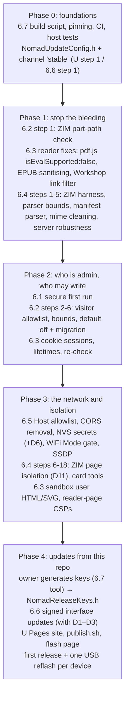

# Nomad security fix plan

This pack turns the security and reliability review of Jcorp Nomad (this fork, `tunlezah/nomad`, reviewed 2026-11-25) into work a coding agent can implement. It covers the seven "Before you use it" steps from section 6 of that review, plus moving all updates to this repo. Each step becomes a code fix, so the device is safe without the owner having to remember the advice. Everything else the review found is listed under [Future fixes](#future-fixes).

**Status: design only.** Nothing here has been implemented. No firmware was compiled or run on a device while writing it: there was no ESP32 toolchain. Pure logic was prototyped and host-tested where the docs say so. Every workstream ends with an on-device test script, and those tests are the real acceptance gate.

## Contents

| ID | Workstream | Replaces this advice from the review | Doc |
|---|---|---|---|
| 6.1 | Secure first run | "Change the hotspot name and password, and set a strong admin password before anyone else joins." | [6.1-secure-first-run.md](6.1-secure-first-run.md) |
| 6.2 | Guest write policy | "Turn visitor uploads off." | [6.2-guest-write-policy.md](6.2-guest-write-policy.md) |
| 6.3 | Untrusted documents and the admin session | "Leave Keep me signed in unticked, and sign out before reading PDFs or EPUBs you didn't put there yourself." | [6.3-untrusted-documents-and-admin-session.md](6.3-untrusted-documents-and-admin-session.md) |
| 6.4 | ZIM archives and the PC card tools | "Only load ZIMs from Kiwix, and only use the PC tools on cards you control." | [6.4-zim-archives-and-card-tools.md](6.4-zim-archives-and-card-tools.md) |
| 6.5 | WiFi Mode hardening | "Prefer hotspot mode. In WiFi Mode, join a guest network and set the admin password first." Also the review's LAN-exposure finding (DNS rebinding, CORS `*`). | [6.5-wifi-mode-hardening.md](6.5-wifi-mode-hardening.md) |
| 6.6 | Signed interface updates | "Update the web interface by re-copying the SD template, not through the in-app updater." | [6.6-signed-interface-updates.md](6.6-signed-interface-updates.md) |
| 6.7 | Reproducible builds and signing tools | "Build the firmware yourself if you want to be sure the binary matches this source." | [6.7-reproducible-builds-and-signing-tools.md](6.7-reproducible-builds-and-signing-tools.md) |
| U | Update hosting on this repo | The owner's request: updates come from `tunlezah/nomad`, not `nomadflash.jcorptech.net`. | [U-update-hosting-on-your-repo.md](U-update-hosting-on-your-repo.md) |

Every doc has the same eleven sections:
- scope, current behaviour and the threat
- the design
- the **power, memory and performance budget**
- the implementation plan (one commit per step)
- tests and acceptance criteria
- rollout
- dependencies
- what was pushed to future fixes
- the owner's open decisions, each with a recommended default

## How a coding agent should use this pack

1. **Read this file first, in full.** The [global rules](#global-rules-the-esp32-power-budget) apply to every change. The [cross-workstream decisions](#cross-workstream-decisions-these-override-the-individual-docs) override an individual doc wherever the two disagree.
2. **Work in the [implementation order](#implementation-order).** Within a workstream, follow its §6 plan one step at a time. Make each step its own commit, and leave the tree building and working after each one.
3. **Every commit must pass these gates:**
   - It builds for **both** boards: USB-A (`s3-usba`) and USB-C (`s3-usbc`). Use `tools/build.sh` once 6.7 lands; before that, use arduino-cli with the FQBN in `tools/flash-nomad.sh`.
   - All host tests pass: `bash tools/guardtest/run.sh`, plus the suites each workstream adds.
   - The commit message states the change's measured or estimated cost against the power budget.
4. **On-device tests.** Run the doc's §7 test script on real hardware before calling a workstream done. Report what failed, not just what passed.
5. **Defaults.** Unless the owner says otherwise, the recommended default in each doc's §11 applies. Record any override in the [decision log](#decision-log).
6. **Stay in scope.** A new problem found along the way goes into [Future fixes](#future-fixes) here. Do not fold it into the current change.
7. **Keep the code style.** Match the existing code: heavily commented, in plain English, explaining *why*.
   - `NomadGuard.h` stays pure and host-testable. Its header notes that every firmware line has an identical copy.
   - Keep fork-specific values in `NomadUpdateConfig.h` (U), so merging upstream stays easy.

## Global rules: the ESP32 power budget

Nomad runs on a USB-powered ESP32-S3 with:
- 512 KB SRAM and 8 MB PSRAM
- 16 MB flash, laid out as two ~3 MB OTA slots plus FAT
- brownout handling, and a web server that already lives close to its internal-RAM floor

**No change may make it power hungry.** Concretely:

1. **No new always-on work.** No new tasks that stay running, no timers, no polling loops, and no radio traffic the device starts by itself. Work that must happen later is done lazily, on the next request that needs it. (6.6's "lazy drop" is the pattern.)
2. **No TLS on the device**, except a one-off the admin starts (the existing firmware pull, which pauses media to afford ~40 KB of internal RAM). Internet work belongs to the phone's browser.
3. **Expensive crypto only at one-off moments, never on the async network task.** That means PBKDF2, ECDSA verify and whole-file hashing, and only at setup, login or update. Run it on a short-lived task that exits:
   - priority at or below the streaming task
   - internal stack only when it writes flash or NVS
   - cleanup done in a work function, so locals are destroyed before `vTaskDelete`

   ESP32-S3 has SHA/AES/MPI hardware; ECDSA P-256 is mostly software.
4. **Per-request cost must be negligible.** String compares and table lookups are fine. Extra card reads, internal-RAM allocations or crypto per request are not. Removing per-reply headers (6.5's CORS removal) counts as a win.
5. **Internal (DMA-capable) heap is the scarcest resource.** About 40 KB is kept free for WiFi under load. New buffers go in PSRAM (`heap_caps_malloc(..., MALLOC_CAP_SPIRAM)`, with no silent internal fallback), stacks stay small, and everything allocated is freed.
6. **Never block the async network task.** More than 5 s there triggers a watchdog reboot, and card waits on it are capped at `NOMAD_NET_CARD_WAIT_MS` (1500 ms).
7. **No extra flash or card wear.** NVS and card writes happen only on owner actions (a few per update or setting change), never per request or on a timer.
8. **No extra screen, backlight or LED activity**, beyond what a one-off event (setup code, recovery) needs.
9. **Measure.** Each workstream's §5 gives its budget and how to measure it:
   - `/api/health`: `memLow`, `dmaFree`, `counts`
   - `/api/support`: `mem.min`, `mem.psramMin`, resets
   - `/api/performance`
   - serial log lines
   - "Sketch uses N bytes" in CI

   A merged change must not lower idle `memLow` or raise idle current draw.

## Cross-workstream decisions (these override the individual docs)

The eight docs were researched in parallel, and these are the points where they differed or depended on each other. Where a doc says otherwise, **this section wins**. Each affected doc carries a short banner pointing here.

**D1. One owner key set signs both firmware and interface updates.**
- Use U's `NomadReleaseKeys.h`: `NOMAD_FW_KEYS[]` of `NomadPubKey {name, der, len}`, with the primary first and an offline backup second, plus `NOMAD_FW_KEY_COUNT`.
- 6.6's separate `NomadUiKey.h` / `NOMAD_UI_KEYS` is **not** created. 6.6's verifier takes the shared list instead.
- Why:
  - The owner signs everything offline (U §4.7, custody A), so 6.6's reason for a separate key ("the UI key may live closer to CI") doesn't apply.
  - One key set halves the backup and rotation burden.
  - Cross-use is already impossible, because the signed bytes start with `NOMADFW1` (firmware) or `NOMADUI 2` (interface).
- 6.7's `nomadfw.py header` writes `NomadReleaseKeys.h`. The owner may still choose separate keys (6.6 §11.1); if so, revert to 6.6 §4.2.

**D2. The update channel is a device setting; a signed interface manifest names the channels it is valid for.**
- U's runtime channel stands: NVS `nomadfw/chan`, `nomadUpdateChannel()`, `POST /api/update/channel`, default `"stable"`. Promoting a release is a pointer move in `release/channels.json`.
- 6.6's grammar line `"channel " chan` becomes **`"channels " chan *(" " chan)`**: 1–4 names, each `[a-z0-9-]{1,24}`.
- `nomadUiPolicy()` checks that the device's **runtime** channel (`nomadUpdateChannel()`) is in that list, instead of comparing with the compile-time `NOMAD_UPDATE_CHANNEL`.
- `publish.sh` signs ordinary releases with `channels experimental stable`, so promotion needs no re-signing. A build that must never reach stable is signed `channels experimental` and has to be re-signed to promote.
- Firmware keeps U's rule: the signed meta `channel` is informational, and the version binding plus anti-rollback do the work.

**D3. The interface manifest's name, place and format.**
- **Format:** 6.6's signed text format.
- **Pages path:** `update/v1/<channel>/ui-manifest.txt`. U's `manifest.json` name is replaced.
- **Release asset:** `ui-manifest-<version>.txt`. U's `ui-manifest-<v>.json` is replaced; change the `ASSETS` table in U's `assemble_site.py` and 6.7's draft-release step accordingly.
- **`base`:** `"../ui/<version>/"`, relative to the manifest URL.
- **URL:** because the channel is a runtime value, 6.6's compile-time `NOMAD_UI_MANIFEST_URL` macro becomes a runtime helper, `nomadUiManifestUrl()` = `NOMAD_UPDATE_BASE + nomadUpdateChannel() + "/ui-manifest.txt"`, used by `GET /api/update/env`.

**D4. One `NomadUpdateConfig.h` holds:**
- `NOMAD_FW_VERSION` (6.7 and U: the only place the version is written)
- `NOMAD_UPDATE_SOURCE`, `NOMAD_UPDATE_BASE`, the default `NOMAD_UPDATE_CHANNEL "stable"`, `NOMAD_FLASH_URL`, `NOMAD_RELEASES_URL`
- the `NomadPubKey` struct
- the key include: `NomadReleaseKeys.h`, or the bench `NomadFirmwareKeyDev.h` when `NOMAD_FW_DEVKEY`
- the `NOMAD_BOARD_ID` block, moved from `NomadFirmware.h` (6.6)

Upstream's `#ifndef` defaults in `NomadUpdate.h` are **left in place as dead code**, per U §4.4, so upstream merges don't conflict. This overrides 6.6's "delete `NomadUpdate.h:37-42`". 6.7's CI check that main builds report `stable` is what guarantees the outcome.

**D5. One verification path.** Build it in this order:
1. 6.7 moves the trailer parsing into `NomadFwTrailer.h` (`fwParseTrailer`) for its host test.
2. 6.6 adds `NomadSign.h` (`nomadSha256`, `nomadP256Verify`).
3. `nomadVerifyAnyKey(const NomadPubKey*, int n, ...)` **returns the index of the matching key, or -1**, so U's `signer` / key-id reporting comes from the same call for firmware and interface updates.

**D6. The admin record moves into NVS, using 6.5's `NomadSecrets.h`.**
- The stored v2 admin key is password-equivalent: the login protocol accepts it as the credential. Today it sits in `/config/settings.json` on the removable card, where USB mode and card removal expose it.
- 6.5 already builds an NVS secret store and a one-time migration for the home WiFi credentials. Extend it with the admin record, using the same pattern:
  - on first boot of the new firmware, copy it to NVS namespace `nomadsec`, then rewrite `settings.json` without it
  - never include it in settings export or backup
- `settings.adminPassword` callers in `NomadAuth.h` read and write through the store. 6.1's BOOT-button recovery clears it there.
- The hotspot password stays where 6.1 puts it (the board password in NVS, a custom password on the card). Everyone on the hotspot knows it anyway.
- Lands as one extra commit in 6.5, after 6.1's auth changes.

**D7. One admin-auth model, built in this order:**
1. **6.1:** `checkAdminAuth()` requires a real session, with no "no password = admin". It adds `nomadAdminPasswordSet()`. `isAdminAuthRequired()` is kept, and is always true on a claimed unit.
2. **6.3:** the session token becomes an HttpOnly, SameSite=Strict cookie that only counts alongside the `X-Nomad-Admin` header. 6.3 adds `checkAdminConfirmed()` (a 5-minute password re-check) for dangerous actions.
3. **Callers:**
   - 6.6's commit and 6.5's WiFi Mode enable call `checkAdminConfirmed()`.
   - 6.6's interim `nomadUpdAdmin()` (`&& isAdminAuthRequired()`) becomes redundant after 6.1 and may stay as a belt-and-braces check.
   - 6.1's `/auth/setup` and firmware `/setup` page issue sessions through 6.3's `authIssue(..., cookieMode=true)`. If 6.1 lands before 6.3, they issue today's token, and 6.3 converts them.

**D8. One front door for requests.** 6.5's front handler is registered before every route. It handles Host allowlisting, the cross-site check before any body is read, and OPTIONS.
- 6.2's middleware rules run after it.
- 6.3's per-path headers (the `CSP: sandbox` for user-folder HTML/SVG) and 6.4's `/zimview` headers are added in the response paths and must not reintroduce `Access-Control-Allow-Origin: *`.
- 6.1's `/setup` and `/auth/setup` must work at the hotspot IP and the six own names; they do under 6.5's allowlist.

**D9. Card tools.**
- **6.4** owns hardening them and moving their source into the repo (`tools/card-tools/`).
- **6.7** builds `Nomad-Card-Tools.zip` deterministically from that source in CI. Until 6.4 lands, keep the committed zip, with a CI check.
- **U's** map-pack path confinement and `NOMAD_PACKS_INDEX` override (U §4.6) are implemented **once**, inside 6.4's card-tools change, not separately.

**D10. Versions.**
- Firmware uses numeric `5.0.1`, `5.0.2`, … (U O5). `fwCompare` reads four numeric parts, so no suffixes like `-rc1`.
- Interface builds carry 6.6's monotonic `build` number (`YYYYMMDDNN`) as well as the version string.

**D11. `/zimview/` is the one CORS exception.**
- **Why it's needed.** 6.4 isolates archive pages by sending `Content-Security-Policy: sandbox …` *without* `allow-same-origin`, which gives each page an opaque origin. The archive's own fetches, fonts and module scripts then arrive with `Origin: null` and need `Access-Control-Allow-Origin: *`. 6.5 removes CORS `*` everywhere else.
- **What applies on `/zimview/*` only:**
  - GET/HEAD replies (redirects included) carry `Access-Control-Allow-Origin: *` with **no credentials, ever**
  - `X-Frame-Options` is removed (it would block the reader's own sandboxed frame)
  - `HTTP_OPTIONS` is answered by 6.4's route, allowing GET, HEAD and OPTIONS with the headers Range, Content-Type, Accept and X-Requested-With
- **Changes to 6.5:**
  - its front handler still runs the Host check first for `/zimview/`, but leaves OPTIONS there to 6.4's route
  - its refusal of `Origin: null` / `same-site` **writes** stays in force everywhere (6.4 depends on it)
  - its "no `Access-Control-Allow-Origin` anywhere" acceptance grep exempts `NomadZimServe.h` only
- **Accepted residual risk:** in WiFi Mode, any web page on the LAN can read *archive* content (Wikipedia-type public material) once it knows the device's address. Other card files stay non-readable cross-origin.

## Implementation order

Each phase ends in a state the owner could release. Phases 1–2 close the review's High findings with small, low-risk changes before the larger redesigns.

Notes on ordering:
- **Phase 0 first.** Every later change then compiles in CI for both boards and runs the host tests. The `experimental` → `stable` channel fix is one line and goes here.
- **Phase 1 items are independent of each other** and can run in parallel. 6.2 step 1 closes the review's worst finding (a guest reading `/config` through a crafted ZIM manifest) on its own. If phase 2 will be a while, turn visitor uploads off on the device by hand in the meantime.
- **Within each doc, follow its own §6 step order.** The phase boxes name step ranges; the dependencies are in each doc's §9.
- **Phase 2's order matters:** 6.1 must land before 6.3's session work, and before 6.5's WiFi Mode gate, which needs `nomadAdminPasswordSet()`.
- **6.5 before 6.4's isolation work**, so ZIM isolation is designed against a server that no longer sends CORS `*`. See 6.4's own notes on any `/zimview`-scoped headers.
- **Phase 4:** U steps 1–6 (config, key list, channel, UI strings) can land early with OTA safely refused (key count 0). The first release waits for the owner's keys. Devices on upstream firmware need one USB reflash to trust the owner's key (U §4.8); OTA cannot make that move.

## Decisions the owner should make before work starts

Recommended defaults are in **bold**. These block design choices; every other §11 item can use its default.

| # | Decision | Recommended | Doc |
|---|---|---|---|
| 1 | Signing-key custody | **Offline, owner signs locally**, with an encrypted primary and an offline backup | U O1 |
| 2 | One key set or separate firmware and interface keys | **One set** (D1) | U O7 / 6.6 §11.1 |
| 3 | Channel model | **Runtime setting, stable by default** (D2) | U O2 |
| 4 | Also trust the upstream author's key | **No** | U O6 |
| 5 | Admin password minimum length | **10 characters** | 6.1 §11.1 |
| 6 | Hotspot name and password for new or default cards | **`Jcorp_Nomad-XXXX`, per-board `xxxx-xxxx-xxxx`** | 6.1 §11.2–3 |
| 7 | Existing cards' visitor-upload setting | **Read as off once, with an admin notice** | 6.2 §11.1 |
| 8 | Kept sign-in lifetime | **30 days absolute, 14 days unused**; end existing kept sign-ins at upgrade | 6.3 §11.1–2 |
| 9 | pdf.js | **Stay on 3.11.174, hardened** (keeps iOS 15); upgrade later | 6.3 §11.3 |
| 10 | DLNA (TV) on the home network in WiFi Mode | **Off for new setups**, kept for existing users | 6.5 §11.4 |
| 11 | Flash or NVS encryption, Secure Boot | **No**: irreversible eFuses, and it conflicts with the GPL "don't lock it down" rule in `LICENSING.md` | 6.5 §11.7, 6.7 §10 |
| 12 | Map packs in the card tools | **Keep the upstream source**, configurable, with paths confined | U O3 |

### Decision log

Record owner overrides here: date, decision number, choice and reason.

| Date | # | Choice | Reason |
|---|---|---|---|
| | | | |

## Future fixes

Everything the review found that is not one of the section-6 steps, plus everything the workstreams deliberately left out. Grouped by kind, with the most worthwhile first in each group. The source is in brackets: R = the review, or a workstream ID.

### Recommended next, small and high value
- **Cap multipart request bodies.** `NomadLimitHandler` skips every `multipart/*` body (`JcorpNomadProject.ino:4619`). The bundled web library then grows non-file fields and part headers into Strings without limit (`src/AsyncWebServer/WebRequest.cpp:812, 854`), so one guest request can exhaust memory. Fix: apply the size limit to multipart requests except on `/upload`, and cap `_itemValue` and `_temp` in the library patch. [R]
- **DLNA Browse stalls the network task.** An uncached folder listing scans the index while holding `sdMutex` (`NomadDLNA.cpp:415, 536-560`); move it to a short-lived task, or cache more cheaply. [R, 6.5]
- **Login lockout abuse.** 20 failures a minute from any address lock everyone out, and the 8-slot per-IP table can be cycled (`NomadGuardWeb.h:164, 200`). [R, 6.1]
- **The plain-password PBKDF2 path runs on the network task** (`NomadAuth.h:204-209, 296`). This breaks global rule 3. [6.1]
- **Routes with empty request handlers never reply to an empty body:** `/led/*`, `/api/mp/*`, `/api/party/*`, and `/upload` with no file part. [R]

### Security, remaining
- **Map pack POI names reach `innerHTML` unescaped** (`assets/maps/nomad-maps.js:763, 765, 781` → `:967`). [R]
- **HTML games in `/Games` run on the device origin.** Needs a second origin or port, shared with 6.4's isolation work. [6.3]
- **A strict CSP on every page**, starting with `admin.html`'s 16 inline handlers. [6.3]
- **Remove the legacy `X-Admin-Token` path** once old UIs are gone. [6.3]
- **Interface lock:** admin file routes refuse interface paths unless a developer toggle is on. [6.6]
- **N64/PS1 emulator cores** load from a CDN with no integrity check. Ship them, or hash-pin them. [R]
- **"Downloads off" only hides the button;** `/media` still serves the file. [R]
- **Unescaped values in JSON replies:**
  - `dnsLastName` in `/api/netdiag` (`ino:6875`)
  - the path in the `/api/index` 202, `/api/index-nested` and `/api/reindex` replies
  - DLNA `xmlEscape` doesn't escape `"` (`ino:2770`)

  [R, 6.5]
- **Bring a host-side `..` read case into `tools/guardtest`.** [R]
- **Visitor uploads:**
  - per-visitor quotas and rate limits
  - letting visitors delete their own uploads
  - restricting Gallery to image and video types
  - a dedicated whiteboard switch

  [6.2]
- **Size caps** for `/Translate/manifest.json` and `/.chat/log.jsonl`. [6.2]
- **The UI config loads only at boot;** reload it after card recovery. [6.2]
- **PAKE or channel binding,** against sniffers who know the hotspot password. [6.1, 6.3]
- **WPA3/PMF** for the hotspot and as a home-network requirement. [6.1, 6.5]
- **An authenticated clock source.** Today a guest phone's clock can end kept sessions early. [6.3]
- **More PBKDF2 iterations.** [6.1]
- **Readers:**
  - a pdf.js 4.x legacy dual engine
  - an epub.js upgrade or replacement
  - SVG blobs inside EPUB/DOCX opened in a new tab
  - a lint for unescaped `${}` in `innerHTML`

  [6.3]
- **Network:**
  - mDNS spoofing defence
  - an SSDP MX random delay
  - IPv6 Host literals
  - admin-editable extra hostnames
  - `async_udp` queueing with `portMAX_DELAY` under UDP floods

  [6.5]
- **A "secure wipe" of old settings copies** from the card's free space. [6.5]

### Reliability
- **Blocking work on the network task:**
  - upload chunk writes on a near-full FAT32 card (can trip the watchdog)
  - the `/listfiles` walk
  - `/api/wifi-scan` switching WiFi mode

  [R]
- **Suspected race:** `/settings` POST reassigns `settings` Strings while the screen task reads them (`ino:7586-7623` vs `2700-2708`). [R]
- **Read-ahead copies from the shared DMA buffer after releasing `sdMutex`** (`NomadReadAhead.h:125-129`). It's safe only while every caller is on the network task. [R]
- **Chat log compaction can lose history on power loss:** the log is removed before the temp file is renamed (`NomadChat.h:277-278`). Chat GET replies can reach ~220 KB per poll. [R]
- **A Range request with start > end returns 1 byte instead of 416.** [R]
- **No thermal throttling:** the temperature is only reported. Consider dropping radio power or refusing new streams above a threshold. That fits the power rule, since it lowers draw. [R]
- **Body callbacks run before the guard middleware.** 6.5's front handler covers the cross-site part; any future body-handler route must still check auth itself. [R, 6.5]

### Updates and supply chain
- **A signed `firmware.json`** (stops version lies and update denial). [U]
- **Phone-relayed firmware:** the phone downloads and sends it to Nomad through the upload path. This removes device TLS and the media pause, a power win. [U]
- **An offline signed interface bundle** (`.nomadui`) for hotspot-only owners. [6.6]
- **A per-file hash cache, a card build marker, clearing orphan `.nomad-new` files at boot, and delta updates.** [6.6]
- **Manifest expiry** (needs trusted time) and multi-signature thresholds. [6.6]
- **A custom domain for the update site, hardware-token signing, an owner-run map-pack mirror, and a full card-setup web flasher.** [U]
- **SLSA or GitHub artifact attestations, Dependabot for the pinned actions, and an on-device check of the build stamp.** [6.7]
- **Byte-identical builds on macOS and Windows; building the toolchain from source.** [6.7]
- **Not planned:** eFuse anti-rollback, Secure Boot and flash encryption. They are irreversible, and they conflict with `LICENSING.md`. [6.7, U]

### Usability
- **Claiming a unit with a broken screen** (the serial console already prints the code), and a saved "admin password was reset" notice. [6.1]

### Archives and card tools
- **Continuous fuzzing** (OSS-Fuzz style) of `NomadZimCore.h` and XZ Embedded. 6.4 adds a host harness, and this would run it continuously. [6.4]
- **Robustness of `nomad-zim.js`** (browser and Node) against huge allocations or loops from crafted archives. DoS only. [6.4]
- **Trusted Types and a full `innerHTML` audit** of every UI page for card-derived strings, beyond `archive.html` and `menu.html`. [6.4]
- **Untrusted input in the PC tools:** `fix_videos.py` runs ffmpeg on untrusted media; `zim_prepare.py` decompresses untrusted clusters in Python (memory bombs). [6.4]
- **Persistent per-archive storage** for archive web apps (needs a second-origin design), a CSP `report-to` endpoint to count broken archive pages, and moving the plain reader to an opaque frame. [6.4]

## Verification status

What this pack rests on, so nobody over-trusts it:

**Read in the code and confirmed by the reviewer:**
- the default credentials
- "no password = admin"
- the ZIM manifest → `/config` read chain
- ZIM parser out-of-bounds reads
- pdf.js 3.11.174 without `isEvalSupported:false`
- epub.js with no iframe sandbox
- the multipart body-cap exemption
- no Host allowlist, and CORS `*`
- unsigned interface updates on the `experimental` channel
- the card tools `require()`-ing JS from the card

**Prototyped on the host by the workstream agents:**
- 6.4's harness, which reproduces the ZIM bugs on today's code (a SEGV at `NomadZimCore.h:351`, 3,992 stale bytes served from an 18-byte cluster, a one-byte over-read at `:751`) and shows the proposed fix refusing all of them
- 6.2's guard rules (226 host tests pass)
- 6.5's Host and SSDP rules (48 cases)
- 6.1's setup-code logic
- 6.6's manifest generator, run against the real template (913 files)
- 6.7's `.nomadfw` packer, checked byte for byte against two real upstream `.nomadfw` files, and a host build of the firmware's trailer check

**Measured live (2026-11-26):** GitHub Pages, Release-asset and raw CORS and redirect behaviour (U).

**Not verified, to measure on the device:**
- ECDSA P-256 verify time on the ESP32-S3 (budget ≤ 2 s on a priority-1 task)
- TLS handshake memory against GitHub's chain
- whether a RESET-button reboot reports as power-on (6.1)
- archive web apps (Zimit 2 and similar) running correctly in an opaque origin with in-memory storage (6.4)
- Safari's handling of a `default-src 'none'` worker CSP (6.3)
- captive-sheet behaviour at the IP origin across iOS, Android and Windows (6.5)
